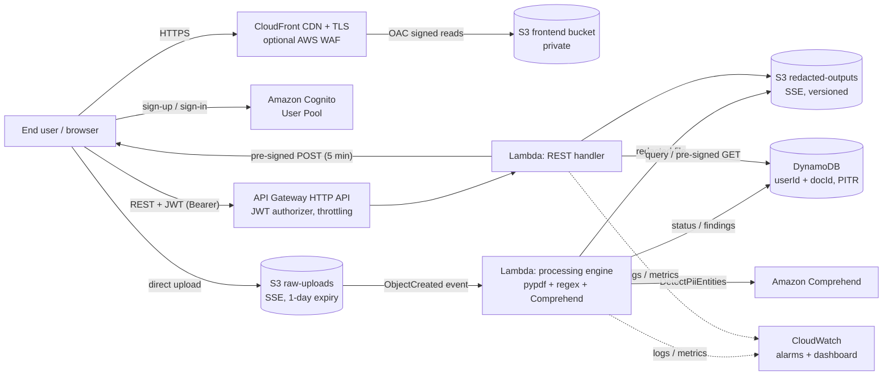

# Architecture

**Cloud pattern:** serverless, event-driven (no servers to manage, scales to zero).

## Request flow

1. User opens `https://<id>.cloudfront.net`. CloudFront serves the React app from a **private** S3 bucket using Origin Access Control.
2. User signs up / signs in with Cognito. The browser receives a short-lived JWT ID token (60 min).
3. `POST /upload-url` → API Lambda validates file type and size, writes a `PENDING_UPLOAD` row in DynamoDB and returns an S3 **pre-signed POST** valid for 5 minutes, locked to one key, one content type and max 10 MB.
4. The browser uploads the file **directly to S3** (Lambda never handles the bytes → cheap and fast).
5. S3 fires an `ObjectCreated` event → processor Lambda:
   * marks the row `PROCESSING`,
   * extracts text (pypdf for PDF, UTF-8 for TXT),
   * runs regex detectors (email, phone, SSN, Luhn-checked cards, Aadhaar, PAN, IP, DOB) and Amazon Comprehend (names, addresses, bank numbers…),
   * merges overlapping findings and replaces them with `[REDACTED:TYPE]`,
   * writes `redacted_<name>.pdf|txt` to the clean bucket,
   * stores per-type counts, engine and duration, and marks the row `COMPLETED` (or `FAILED`).
6. The UI polls `GET /documents`; when done, `GET /documents/{id}` returns a 5-minute pre-signed download link.

## Services used (grading pillar 2)

| Layer | Service | Why |
|---|---|---|
| Compute | AWS Lambda (Python 3.12) ×2 | Event-driven, pay-per-ms |
| Object storage | Amazon S3 ×3 (raw, clean, frontend) | Isolation of PII originals vs outputs vs public site |
| Database | Amazon DynamoDB | Single-table, key `userId`/`docId`, millisecond lookups |
| Identity | Amazon Cognito | Sign-up, email verification, optional TOTP MFA, JWT |
| API / networking | API Gateway HTTP API | JWT authorizer, CORS, throttling |
| CDN + TLS | Amazon CloudFront | Global edge caching, HTTPS, security headers |
| AI | Amazon Comprehend | ML-based PII entity detection |
| Edge security | AWS WAF (optional) | Rate limiting + AWS managed rules |
| Monitoring | Amazon CloudWatch | Logs, 5 alarms, dashboard |
| IaC | AWS CloudFormation (SAM transform) | Whole stack reproducible in minutes |

## DynamoDB item

| Attribute | Example |
|---|---|
| `userId` (PK) | Cognito `sub` |
| `docId` (SK) | UUID v4 |
| `fileName`, `sizeBytes` | `resume.pdf`, `48211` |
| `status` | `PENDING_UPLOAD` → `PROCESSING` → `COMPLETED` / `FAILED` |
| `piiCounts`, `piiTotal` | `{"EMAIL":2,"PHONE":1}`, `3` |
| `engine`, `processingMs` | `regex+comprehend`, `840` |
| `createdAt`, `updatedAt` | ISO-8601 timestamps |

## Known limitations

* Output PDF is a clean **text re-render** (original layout/images are not kept) — this guarantees no hidden PII survives in the file.
* Scanned (image-only) PDFs have no text layer; adding Amazon Textract would be the next step.
