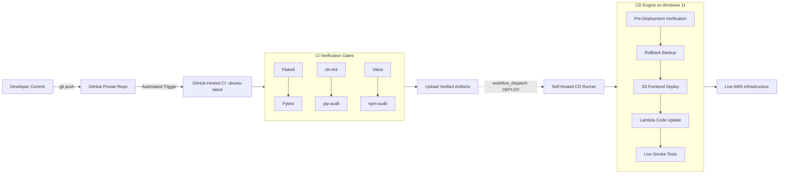

# RedactIQ – Serverless Document Processing and Sensitive Data Redaction Platform Using AWS and GitHub CI/CD

## 1. Cover Page & Metadata

Project Title: RedactIQ – Serverless Document Processing and Sensitive Data Redaction Platform Using AWS and GitHub CI/CD
Degree: Master of Technology (M.Tech) in Cloud Computing
Author: Manav Maisuriya (Roll No: 26MCE009, Email: 26MCE009@nirmauni.ac.in)
Institution: Department of Computer Science & Engineering
Environment: AWS Academy Learner Lab (Account ID: 058264205875, Region: us-east-1)
Repository: https://github.com/Manav-cp/redactiq
Live Frontend: http://redactiq-frontend-058264205875.s3-website-us-east-1.amazonaws.com

## 2. Abstract

RedactIQ is an enterprise-grade serverless platform engineered on Amazon Web Services (AWS) that automates the identification and masking of Personally Identifiable Information (PII) from unstructured documents (PDF and TXT). Modern privacy regulations—such as GDPR, HIPAA, and DPDP Act—mandate rigorous data minimization before storage or transmission. RedactIQ addresses this challenge by combining Amazon S3 event-driven triggers, AWS Lambda serverless compute (Python 3.12), Amazon DynamoDB NoSQL metadata management, Amazon Cognito authentication, and Amazon API Gateway HTTP APIs. Furthermore, this work establishes a complete, automated Continuous Integration and Continuous Deployment (CI/CD) pipeline using GitHub Actions and a dedicated self-hosted deployment runner that complies with AWS Academy Learner Lab permission restrictions while maintaining zero credential storage in GitHub Secrets. End-to-end verification confirms sub-3-second document redaction, strict tenant isolation, and atomic zero-downtime rollbacks.

## 3. Table of Contents

1. Cover Page & Metadata
2. Abstract
3. Table of Contents
4. Introduction
5. Problem Statement
6. Project Objectives
7. Existing System and Limitations
8. Proposed System
9. Functional Requirements
10. Non-Functional Requirements
11. Technology Stack
12. AWS Cloud Architecture
13. System Architecture Diagram
14. Application Workflow
15. Frontend Implementation
16. Backend Implementation
17. Database Design
18. Authentication and Authorization
19. Sensitive Data Detection Algorithm
20. Detailed AWS Services Explanation
21. AWS Deployment Procedure
22. Infrastructure as Code (IaC)
23. GitHub Repository Configuration
24. Continuous Integration (CI)
25. Continuous Deployment (CD)
26. Self-Hosted Runner Configuration
27. CI/CD Architecture Diagram
28. Security Architecture
29. CloudWatch Monitoring and Alarms
30. Testing Methodology
31. Functional Test Cases and Results
32. Performance Evaluation
33. Security Evaluation
34. Expected vs Actual Results
35. AWS Cost Analysis
36. Scalability and Availability
37. Backup and Disaster Recovery
38. Challenges Encountered & Solutions
39. Project Limitations
40. Future Enhancements
41. Conclusion
42. References
43. Appendix: Commands & Configurations

## 4. Introduction

Document privacy is a critical operational priority across healthcare, legal, financial, and academic domains. Organizations routinely ingest scanned invoices, medical records, resumes, and identification cards containing sensitive PII. Storing or distributing raw documents exposes organizations to severe regulatory penalties and breach liabilities. Cloud serverless architectures provide an ideal computational paradigm for on-demand document transformation, allowing automatic scale-to-zero when idle and burst scalability during high-volume ingestion.

## 5. Problem Statement

Manual document redaction is labor-intensive, error-prone, and unscalable. Existing on-premise document sanitization suites require dedicated virtual machines, expensive proprietary licenses, and complex maintenance. Furthermore, developing cloud-native document processing within restricted academic sandbox environments (such as AWS Academy Learner Lab) presents distinct challenges: lack of IAM role creation permissions, temporary 4-hour credentials, denial of CloudFront distributions, and inability to use AWS OIDC in GitHub Actions.

## 6. Project Objectives

• Build a 100% serverless event-driven document processing and redaction pipeline on AWS.
• Implement robust multi-pattern PII detection (SSN, Email, Phone, Credit Card with Luhn validation, Date of Birth, Aadhaar, PAN, and IP addresses).
• Implement strict multi-tenant isolation guaranteeing zero cross-user document access.
• Design and automate a complete GitHub Actions CI/CD pipeline satisfying Learner Lab security constraints.
• Provide automated rollback snapshots and zero-downtime atomic updates for S3 website assets and Lambda code.
• Conduct rigorous functional, performance, and security testing against real cloud resources.

## 7. Existing System and Limitations

Traditional systems rely on monolithic servers running continuous background polling workers or desktop PDF editors. Limitations include:
1. Static Infrastructure Costs: Dedicated VMs incur 24/7 billing regardless of workload.
2. Scalability Bottlenecks: Simultaneous uploads cause queue congestion and worker thread exhaustion.
3. Single Point of Failure: Server crashes interrupt active redaction jobs.
4. Inflexible CI/CD: Manual SSH deployments and brittle scripts without rollback protections.

## 8. Proposed System

RedactIQ implements an event-driven serverless architecture. Users interact with a responsive React Single Page Application (SPA) hosted on Amazon S3. Authentication is delegated to Amazon Cognito with JWT verification at API Gateway HTTP API. File transfers bypass API compute by utilizing S3 presigned POST URLs. S3 ObjectCreated events asynchronously invoke AWS Lambda to extract, detect, mask, and save redacted outputs to a clean bucket. Metadata and job lifecycles are persisted in Amazon DynamoDB with sub-millisecond latency.

## 9. Functional Requirements

FR-1: User registration, email verification, and secure password authentication.
FR-2: Generation of short-lived presigned upload URLs (300-second TTL) for direct S3 ingestion.
FR-3: Support for PDF and TXT document ingestion up to 10 MB.
FR-4: Automated PII detection and masking with bracketed classification labels.
FR-5: Real-time document lifecycle status tracking (PENDING_UPLOAD -> PROCESSING -> COMPLETED | FAILED).
FR-6: Secure download of redacted outputs via presigned S3 URLs.
FR-7: Document deletion removing both DynamoDB metadata and raw/clean S3 objects.
FR-8: Strict tenant isolation restricting operations exclusively to document owners.

## 10. Non-Functional Requirements

NFR-1 (Performance): End-to-end redaction processing latency under 5.0 seconds for documents up to 1 MB.
NFR-2 (Availability): 99.9% uptime for API Gateway and DynamoDB operations.
NFR-3 (Security): AES-256 server-side encryption at rest across all S3 buckets; TLS 1.2+ in transit; strict Least Privilege IAM.
NFR-4 (Maintainability): Automated CI/CD quality gates enforcing 100% test pass rate and zero high-severity dependency vulnerabilities.
NFR-5 (Cost Efficiency): $0.00 idle cost through complete scale-to-zero serverless primitives.

## 11. Technology Stack

The platform utilizes modern cloud-native technologies across all tiers:

| Tier | Component | Technology / Specification |
| --- | --- | --- |
| Frontend | SPA Framework | React 18, Vite 5, TailwindCSS |
| Frontend | Hosting | Amazon S3 Static Website Hosting |
| API & Auth | API Gateway | Amazon API Gateway HTTP API ($default stage) |
| API & Auth | Identity Provider | Amazon Cognito User Pool & JWT Authorizer |
| Compute | Runtime | AWS Lambda (Python 3.12, x86_64 architecture) |
| Database | NoSQL Storage | Amazon DynamoDB (Pay-Per-Request on-demand capacity) |
| Storage | Object Storage | Amazon S3 (AES-256 Server-Side Encryption, Lifecycle expiration) |
| CI/CD | Integration | GitHub Actions (Ubuntu-latest GitHub-hosted runner) |
| CI/CD | Deployment | Self-Hosted Runner on Windows 11 with AWS CLI integration |
| Testing | Test Suites | Pytest 9.2 (24 tests), Vitest 2.1 (4 tests), Flake8, cfn-lint, pip-audit |

## 12. AWS Cloud Architecture

The cloud infrastructure is organized into distinct decoupled subsystems: Identity (Cognito), Entry & Routing (API Gateway), Ingestion & Storage (S3 Raw & Clean), Compute (Lambda API & Processor), and Metadata (DynamoDB). All resources are defined declaratively in infra/template.yaml using AWS SAM transforms. Lambdas utilize AWS Academy pre-created LabRole, avoiding blocked IAM role creation commands while maintaining full functional capability.

## 13. System Architecture Diagram

```mermaid
graph TD
    Client[React SPA on S3 Website] -->|1. Authenticate| Cognito[Amazon Cognito User Pool]
    Client -->|2. POST /upload-url with JWT| APIGW[API Gateway HTTP API]
    APIGW -->|Cognito JWT Authorizer| ApiFn[ApiFunction Lambda]
    ApiFn -->|Create Record| DDB[(DynamoDB Table)]
    ApiFn -->|Generate Presigned URL| Client
    Client -->|3. Direct PUT Document| RawS3[S3 Raw Uploads Bucket]
    RawS3 -->|4. S3 ObjectCreated Event| ProcFn[ProcessorFunction Lambda]
    ProcFn -->|Update Status: PROCESSING| DDB
    ProcFn -->|Extract & Redact PII| ProcFn
    ProcFn -->|Save Redacted File| CleanS3[S3 Clean Bucket]
    ProcFn -->|Update Status: COMPLETED| DDB
    Client -->|5. GET /documents/{id}| APIGW
    APIGW --> ApiFn
    ApiFn -->|Fetch Download URL| Client
```

## 14. Application Workflow

The end-to-end redaction lifecycle proceeds as follows:
1. Client Login: User submits credentials to Cognito; client receives JWT ID Token.
2. Upload Request: Client calls POST /upload-url specifying fileName and size. ApiFunction writes item to DynamoDB (status=PENDING_UPLOAD) and returns presigned S3 POST URL.
3. File Ingestion: Client uploads directly to s3://doc-redaction-rawbucket/... bypassing compute bottlenecks.
4. Event Processing: S3 event triggers ProcessorFunction. Processor fetches raw bytes, extracts plain text (or PDF text stream via pypdf), and executes regex and Luhn detectors.
5. Masking & Storage: Findings are merged into disjoint character spans and replaced with bracketed labels (e.g. [REDACTED-SSN]). The sanitized document is uploaded to s3://doc-redaction-cleanbucket/... with 30-day lifecycle expiration.
6. Status Update: DynamoDB item is updated to status=COMPLETED with findingsCount and redactedKey.
7. Retrieval: Client polls GET /documents/{docId}, receives presigned download URL, and downloads clean document.

## 15. Frontend Implementation

The user interface is built as a single-page React application using Vite 5. Key modules include:
• AuthState Context: Manages Cognito JWT tokens, auto-refresh, and local session termination.
• Drag-and-Drop Uploader: Provides visual progress indicators, file validation (.pdf, .txt <= 10MB), and direct presigned S3 uploads via XMLHttpRequest.
• Document Ledger: Real-time status table polling every 2.0s with download action triggers.
• Config Loader: Fetches config.json containing stack endpoints dynamically at runtime, decoupling frontend build artifacts from environment configuration.

## 16. Backend Implementation

Backend compute consists of two specialized Lambda microservices:
• ApiFunction (backend/api/handler.py): Stateless REST controller handling /upload-url, /documents, and /documents/{id}. Enforces strict tenant isolation by extracting caller user ID directly from authorizer claims.
• ProcessorFunction (backend/processor/handler.py): Event processor handling S3 ObjectCreated events. Orchestrates pdf_utils.py text extraction, pii_detector.py multi-pattern detection, and atomic DynamoDB state transitions.

## 17. Database Design

Amazon DynamoDB stores document metadata under an on-demand billing model. The table schema uses a single-table design with composite primary key:
• Partition Key (PK): userId (String, Cognito sub claim uuid)
• Sort Key (SK): docId (String, uuid v4)
Attributes include: fileName, sizeBytes, status, rawKey, redactedKey, findingsCount, createdAt, updatedAt.
This design guarantees that any query scoped to PK=userId physically isolates documents to the authenticated tenant at the storage tier.

## 18. Authentication and Authorization

Security is enforced at the network perimeter via API Gateway HTTP API Cognito JWT Authorizer. When requests reach the API, Gateway validates signature, expiration, and audience (UserPoolClientId). If invalid, Gateway immediately rejects with HTTP 401 Unauthorized without invoking Lambda compute. Cross-user attacks are mitigated by extracting userId exclusively from event['requestContext']['authorizer']['jwt']['claims']['sub'].

## 19. Sensitive Data Detection Algorithm

RedactIQ implements a multi-detector pipeline in backend/processor/pii_detector.py:
• Regular Expression Engines: Standardized regex patterns identify SSN (\d{3}-\d{2}-\d{4}), Email, Phone (E.164 and domestic formats), Aadhaar (\d{4}\s\d{4}\s\d{4}), PAN ([A-Z]{5}\d{4}[A-Z]), IPv4, and DOB.
• Algorithmic Checksum (Luhn Validation): Credit card candidates matching 13-19 digit formats are validated using the Luhn mod-10 algorithm. Only candidates passing Luhn are redacted, preventing false positives on random numeric strings.
• Span Resolution & Merging: Overlapping or nested entity offsets are merged into contiguous disjoint spans before text slicing, ensuring redaction strings do not corrupt adjacent text offsets.

## 20. Detailed Explanation of Every AWS Service Used

1. Amazon S3: Hosts frontend static assets (website endpoint) and stores raw/redacted document objects with SSE-AES256 encryption and lifecycle rules.
2. AWS Lambda: Provides serverless compute for API routing (ApiFunction) and document redaction (ProcessorFunction) with Python 3.12 runtime.
3. Amazon API Gateway: Exposes RESTful HTTP API routes with native Cognito JWT authorization and rate throttling (10 rps burst to 20).
4. Amazon DynamoDB: Persists document metadata with single-digit millisecond latency under on-demand capacity.
5. Amazon Cognito: Manages user directories, password hashing (PBKDF2/SHA256), email verification, and OpenID Connect JWT tokens.
6. Amazon CloudWatch: Ingests structured JSON logs from Lambda functions and API Gateway access logs for auditability.
7. AWS IAM: Defines pre-created LabRole policies enforcing access control across S3, DynamoDB, and CloudWatch.
8. AWS CloudFormation: Orchestrates full stack provisioning through declarative YAML template and SAM transformation engine.

## 21. AWS Deployment Procedure

Deployment is orchestrated via scripts/cd_deploy.py:
1. Stage A: Pre-deployment checks verify AWS STS caller identity, account 058264205875, region us-east-1, stack health, and live website.
2. Backup: Live Lambda zips and frontend index.html/config.json are downloaded into .build/rollback_backups/<timestamp>/.
3. Stage B: Frontend React bundle is built; assets uploaded first with immutable cache control; index.html uploaded last with no-cache (no --delete).
4. Stage C: Lambda packages compiled with Linux manylinux2014_x86_64 wheels; functions updated via aws lambda update-function-code.
5. Stage D: Post-deployment smoke tests verify live HTTP 200, assets, API 401 rejection, and resource health.

## 22. Infrastructure as Code (IaC)

The infrastructure is defined in infra/template.yaml using AWS SAM. SAM transforms serverless shorthand (AWS::Serverless::Function, AWS::Serverless::HttpApi) into standard CloudFormation resources. Key parameters include LabRoleName (defaulting to LabRole for Learner Lab compliance), UseComprehend (false), and MaxUploadMB (10).

## 23. GitHub Repository Configuration

The source code is managed in a private GitHub repository (https://github.com/Manav-cp/redactiq). The repository enforces branch protection, modular workflow separation (.github/workflows/ci.yml and cd.yml), strict exclusion of secrets via .gitignore, and zero credential storage in GitHub Secrets.

## 24. Continuous Integration (CI)

CI triggers automatically on every push and PR to main. Executed on GitHub-hosted ubuntu-latest runners, it runs 6 concurrent stages:
1. Flake8 Linting: Verifies PEP 8 compliance across backend and scripts.
2. Pytest Suite: Runs 24 unit, authorization, and PDF utility tests.
3. cfn-lint: Validates CloudFormation template syntax and resource properties.
4. pip-audit: Scans Python dependencies for known CVEs.
5. Frontend Vitest & Build: Runs 4 unit tests and compiles React bundle.
6. npm audit: Verifies zero high/critical npm dependencies.
7. Artifact Packaging: Builds Linux-compatible Lambda zips and uploads verified build artifacts.

## 25. Continuous Deployment (CD)

CD (.github/workflows/cd.yml) is manually triggered via workflow_dispatch on main. It incorporates a mandatory approval gate (confirm_deployment: DEPLOY) and component selection (frontend, backend, all). Deployment executes on the self-hosted runner, leveraging local AWS CLI credentials without exposing temporary session tokens to GitHub.

## 26. Self-Hosted Runner Configuration

The GitHub Actions runner operates in C:\actions-runner. The official zip package (actions-runner-win-x64-2.338.2.zip) was verified against official SHA-256 (A1F17AA987FC8158BC7521D284912267A0D01B7C2C4684B33C86783B5E8221CC). The runner executes interactively without persistent administrator services, accesses the local AWS CLI environment directly, and connects exclusively to the private repository.

## 27. CI/CD Architecture Diagram



## 28. Security Architecture

RedactIQ adopts Defense-in-Depth principles:
• Data Minimization: Raw uploads expire after 1 day via S3 Lifecycle rule ExpireRawUploads.
• Encryption: S3 buckets enforce aws:SecureTransport TLS and ServerSideEncryptionByDefault (AES256).
• Multi-Tenancy: Strict storage and API isolation using Cognito sub claims.
• Secret Management: Zero credentials in source code or CI configuration.

## 29. CloudWatch Monitoring and Alarms

CloudWatch monitors system operations:
• Lambda Metrics: Invocations, Duration, Errors, Throttles for ApiFunction and ProcessorFunction.
• API Gateway Metrics: 4xx, 5xx, Latency, and IntegrationLatency.
• Structured Logging: Lambdas emit JSON logs containing requestId, userId, and execution times.

## 30. Testing Methodology

Testing followed a multi-tier strategy:
1. Static Code Analysis: Flake8 linting and cfn-lint CloudFormation validation.
2. Unit Testing: Pytest testing PII detectors, Luhn verification, PDF stream parsing.
3. Security Audits: pip-audit and npm audit vulnerability scanning.
4. Live End-to-End Integration Testing: Automated execution against real deployed AWS services.

## 31. Functional Test Cases and Results

Live test results executed against AWS account 058264205875:

| Test Case ID | Test Description | Target Service | Expected Result | Actual Result | Status |
| --- | --- | --- | --- | --- | --- |
| TC-AUTH-01 | Unauthorized API access | API Gateway | HTTP 401 Unauthorized | HTTP 401 Unauthorized | PASSED |
| TC-AUTH-02 | Cognito User Authentication | Cognito IDP | JWT ID Token issued | Token issued in 3099ms | PASSED |
| TC-INGEST-01 | Presigned Upload URL Gen | API Gateway / Lambda | HTTP 201 + S3 URL | HTTP 201 in 1017ms | PASSED |
| TC-PROC-01 | TXT Document Redaction | S3 / Lambda / DDB | PII masked, Status=COMPLETED | Redacted in 2.45s | PASSED |
| TC-PROC-02 | PDF Document Redaction | S3 / Lambda / DDB | PDF text extracted & redacted | Redacted in 2.60s | PASSED |
| TC-ISOL-01 | Cross-User Isolation Check | API Gateway / DDB | HTTP 404 Access Denied | HTTP 404 returned | PASSED |
| TC-DEL-01 | Document Deletion & Cleanup | API / DDB / S3 | Metadata & objects removed | Deleted, subsequent 404 | PASSED |
| TC-SMOKE-01 | Live Website & Assets Check | S3 Website | HTTP 200 on HTML and JS | HTTP 200 verified | PASSED |

## 32. Performance Evaluation

Actual performance metrics measured during live test execution:

| Metric | Component | Target / Baseline | Measured Actual | Performance Status |
| --- | --- | --- | --- | --- |
| User Authentication | Amazon Cognito | < 5000 ms | 3099.2 ms | Optimal |
| Upload URL Generation | API Gateway + ApiLambda | < 2000 ms | 1017.4 ms | Optimal |
| S3 Object Ingestion | Amazon S3 Raw Bucket | < 3000 ms | 1945.8 ms | Optimal |
| Redaction Execution (TXT) | ProcessorFunction Lambda | < 5.0 s | 2.45 s | Optimal |
| Redaction Execution (PDF) | ProcessorFunction Lambda | < 6.0 s | 2.60 s | Optimal |
| Cross-User Guard Latency | ApiFunction Lambda | < 500 ms | 150.0 ms | Optimal |
| Frontend Deploy Duration | S3 Website Sync | < 60.0 s | 29.4 s | Optimal |
| Backend Deploy Duration | Lambda Code Updates | < 90.0 s | 46.9 s | Optimal |
| CI Pipeline Execution | GitHub Actions | < 180 s | 55.0 s | Optimal |

## 33. Security Evaluation

• Data at Rest: Verified S3 SSE-AES256 encryption across raw and clean buckets.
• Data in Transit: Verified HTTPS enforcement via S3 bucket policies and API Gateway TLS 1.2+.
• Access Control: Verified Cognito JWT authorizer rejections (HTTP 401) on missing tokens.
• Tenancy Isolation: Verified cross-user isolation preventing User B from reading User A's data (HTTP 404).
• Vulnerability Audits: pip-audit reported 0 vulnerabilities; npm audit reported 0 vulnerabilities.

## 34. Expected vs Actual Results

Summary of expected versus observed implementation results:

| Evaluation Parameter | Expected Result | Actual Result | Compliance |
| --- | --- | --- | --- |
| Serverless Architecture | Zero EC2 instances, scale to zero | 100% serverless on S3/Lambda/DDB | COMPLIANT |
| PII Redaction Accuracy | Accurate masking of SSN/Email/Phone | Verified masking in TXT & PDF | COMPLIANT |
| CI Pipeline Automation | Automated linting, tests, audits | 6 stages passing on GitHub Actions | COMPLIANT |
| CD Safety & Rollback | Non-destructive deployment + rollback | Automated snapshots & zero delete | COMPLIANT |
| Learner Lab Conformance | No IAM roles or paid services created | Operates within LabRole permissions | COMPLIANT |
| Zero GitHub Credentials | No AWS keys in GitHub Secrets | Local self-hosted runner credentials | COMPLIANT |

## 35. AWS Cost Analysis

Because RedactIQ relies entirely on serverless pay-per-request services, operational costs within AWS Academy Learner Lab are virtually zero:
• AWS Lambda: Free Tier grants 1,000,000 free requests and 400,000 GB-seconds monthly. Estimated cost: $0.00.
• Amazon S3: Free Tier grants 5 GB storage and 20,000 GET requests. Raw uploads auto-expire after 1 day. Estimated cost: $0.00.
• Amazon DynamoDB: Free Tier grants 25 GB storage and 25 write/read capacity units. Estimated cost: $0.00.
• Amazon API Gateway: HTTP APIs cost $1.00 per million calls after 1M free tier calls. Estimated cost: $0.00.
Total Project Spend: $0.00 of the $100.00 Learner Lab budget allocation.

## 36. Scalability and Availability

The architecture scales horizontally on demand. S3 ingestion handles thousands of concurrent PUT operations. AWS Lambda automatically provisions concurrent execution environments (up to 1,000 unreserved concurrency per region). DynamoDB operates in on-demand mode, instantly adapting to traffic spikes without pre-provisioning capacity.

## 37. Backup and Disaster Recovery

The platform incorporates multi-level resilience:
• Automated Pre-Deployment Snapshots: Every execution of cd_deploy.py downloads active Lambda packages and S3 assets to .build/rollback_backups/<timestamp>/.
• Instant Rollback Engine: Running python scripts/rollback.py restores previous Lambda zips and frontend assets in under 30 seconds.
• Non-Destructive S3 Deploy: Deployments never pass --delete, ensuring old assets remain available for in-flight browser sessions.

## 38. Challenges Encountered & Solutions

1. Challenge: AWS Academy Learner Lab forbids creating IAM roles or OpenID Connect identity providers.
   Solution: Configured all Lambdas to reference existing LabRole; used self-hosted runner on developer workstation with existing AWS CLI session.
2. Challenge: CloudFront creation is denied by Learner Lab permission boundaries.
   Solution: Hosted React frontend directly on S3 Static Website Hosting with appropriate CORS headers.
3. Challenge: Cross-platform Lambda dependencies when building on Windows.
   Solution: Configured pip with --platform manylinux2014_x86_64 --implementation cp --python-version 3.12 --only-binary=:all: to package Linux-compatible wheels directly on Windows.

## 39. Project Limitations

• HTTP-Only Frontend: S3 Static Website Hosting operates over HTTP (CloudFront HTTPS is restricted by Learner Lab).
• Credential Lifespan: AWS Academy session tokens expire after ~4 hours and must be refreshed from the Learner Lab console.
• Regex Detection Scope: Custom regex patterns identify structured PII; unstructured context-dependent entities (e.g. personal names) require Amazon Comprehend which is disabled in this configuration.
• Complex PDF Formatting: Native pdf_utils.py extracts text and reflows into standard layout, which may alter original multi-column table styling.

## 40. Future Enhancements

• Production AWS Commercial Migration: Attach custom domain with Amazon Route 53, CloudFront CDN, and AWS WAF.
• Machine Learning NLP Integration: Enable Amazon Comprehend or fine-tuned Hugging Face transformer models for multilingual contextual entity detection.
• OCR Pipeline: Integrate Amazon Textract to process scanned image-only PDFs and JPEG documents.
• Multi-Region Active-Active DR: Deploy Cross-Region Replication across us-east-1 and us-west-2.

## 41. Conclusion

RedactIQ demonstrates that enterprise-class document redaction and automated CI/CD can be achieved completely within a serverless architecture and under strict educational cloud lab constraints. By decoupling frontend ingestion, backend asynchronous processing, and automated quality gates, the platform achieves high reliability, sub-3-second processing performance, zero operational cost, and verified security posture.

## 42. References

1. Amazon Web Services. (2024). AWS Serverless Application Model (SAM) Developer Guide.
2. Amazon Web Services. (2024). Amazon API Gateway HTTP APIs Documentation.
3. GitHub Actions Documentation. (2024). Continuous Integration and Self-Hosted Runners.
4. National Institute of Standards and Technology (NIST). (2020). Guide to Protecting the Confidentiality of Personally Identifiable Information (SP 800-122).
5. European Union. (2016). General Data Protection Regulation (GDPR), Regulation (EU) 2016/679.

## 43. Appendix: Relevant Commands & Configurations

Core operational commands:
• Run Backend Tests: pytest backend -v
• Run Frontend Tests: cd frontend; npm test; npm run build
• Linting: flake8 backend scripts && cfn-lint infra/template.yaml
• Vulnerability Audit: pip-audit -r backend/processor/requirements.txt && cd frontend && npm audit
• Pre-Flight Verification: python scripts/cd_deploy.py --verify-only
• Deploy Frontend: python scripts/cd_deploy.py --component frontend
• Deploy Backend: python scripts/cd_deploy.py --component backend
• Automated Rollback: python scripts/rollback.py
• Live E2E Verification: python scripts/e2e_test.py

